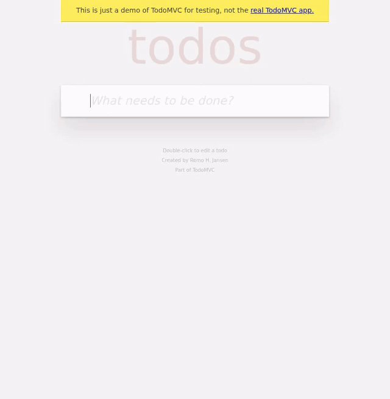
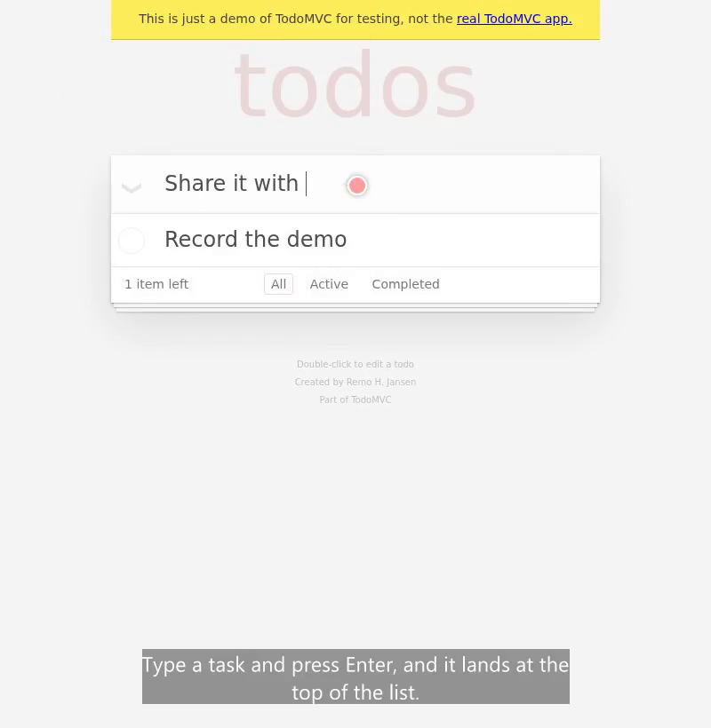
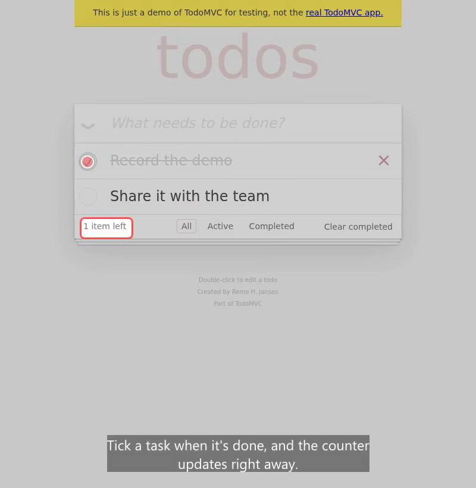
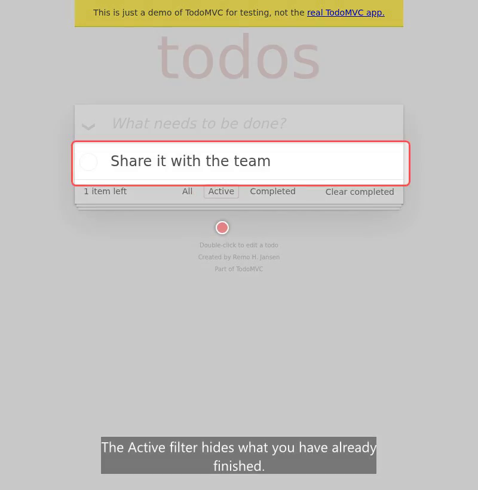

<div align="center">

# feature-showcase

**Narrated, subtitled demo videos of your branch, recorded by Claude Code.**

Point it at a running web app. It reads your docs and the branch diff, writes the demo, records
it in a real browser with a voice-over and burned-in subtitles, and hands the video over for
your pull request.



<sub>Recorded with <code>example.scenes.mjs</code> against the public TodoMVC demo.</sub>

</div>

---

## Contents

- [Why](#why)
- [What you get](#what-you-get)
- [Requirements](#requirements)
- [Installation](#installation)
- [Usage](#usage)
- [Configuration](#configuration)
- [Writing scenes](#writing-scenes)
- [Narration](#narration)
- [CLI reference](#cli-reference)
- [Privacy and safety](#privacy-and-safety)

## Why

Screenshots in a PR show a state. A reviewer needs to see the flow: what the user clicks, what
changes, what happens when something goes wrong. Recording that by hand takes a screen recorder,
a quiet room and several takes, and it goes stale on the next push.

`feature-showcase` turns the demo into code. The agent plans it, scripts it with Playwright and
dry-runs it until every step passes. Then it records the video and checks the frames before you
see it. To re-record after a change, run the command again.

## What you get

| Typing, with a visible cursor | Highlights on what matters | Subtitles for every line |
| :---: | :---: | :---: |
|  |  |  |

- **One MP4** with narration mixed in and subtitles burned in, plus an `.srt` file.
- **Multi-tab recording.** Popups, OAuth windows and third-party apps the feature touches end up
  in the same video, cut in the order they were on screen.
- **Optional extras:** one screenshot and one GIF per scene. Each GIF stays under GitHub's 10 MB
  inline limit.
- **A PR handoff.** The media is copied to your Downloads folder and the PR opens in your
  browser, ready to drag in.

## Requirements

- [Claude Code](https://claude.com/claude-code)
- Node.js 20 or newer
- The [GitHub CLI](https://cli.github.com) (`gh`), signed in, for the PR steps
- Linux, macOS or WSL. On a bare Linux or WSL install, `setup.sh` fetches the libraries Chromium
  needs without `sudo`.

## Installation

```bash
git clone git@github.com:pefelippe/feature-showcase.git ~/.claude/skills/feature-showcase
bash ~/.claude/skills/feature-showcase/setup.sh
```

`setup.sh` installs ffmpeg, Playwright with Chromium, and the local Kokoro voice. It prints
`Ready.` when everything is in place.

Check that it works by recording the bundled example:

```bash
cd ~/.claude/skills/feature-showcase
node showcase.mjs record --scenes example.scenes.mjs --out /tmp/showcase-example --no-login
```

## Usage

In Claude Code, on the branch you want to show:

```
/feature-showcase
```

Add context to steer it. Plain instructions and paths to Markdown files both work:

```
/feature-showcase show the new export button on a report with data, then the
error toast when the export fails. Read docs/exports.md first. --gifs --update-pr
```

The agent then:

1. loads your project config and reads the docs it lists;
2. checks the app is up, and asks you to start it if it isn't;
3. plans the demo from your instructions, the diff and the PR description;
4. writes the scenes and dry-runs them with `--check` until every step passes;
5. records, then builds a contact sheet and looks at it before handing anything over;
6. with `--update-pr`, puts the files in your Downloads folder and opens the PR.

| Flag | Effect |
| --- | --- |
| `--update-pr` | Hand the media over for the PR description |
| `--screenshots` | One screenshot at the end of each scene |
| `--gifs` | One GIF per scene, subtitles included |
| `--clean` | Delete local files once the media is in the PR |
| `--lang <code>` | Narration language |
| `--user <id>` | Who to sign in as |
| `--no-narration` | Silent video, subtitles only |

## Configuration

Each project gets a small config file. The first one found wins:

1. the file given with `--config`
2. `showcase.config.mjs` or `.showcase.config.mjs` at the project root
3. `~/.config/feature-showcase/<project folder name>.config.mjs`, to keep it out of the repository

```js
export default {
  baseUrl: 'http://localhost:3000',
  healthCheck: '/api/health',
  startCommand: 'npm run dev',
  docs: ['README.md', 'docs/testing.md'],
  baseBranch: 'main',
  user: 'demo@example.com',
  async login({ context, user }) {
    const page = await context.newPage();
    await page.goto('/login');
    await page.getByLabel('Email').fill(user);
    await page.getByLabel('Password').fill(process.env.SHOWCASE_PASSWORD ?? '');
    await page.getByRole('button', { name: 'Sign in' }).click();
    await page.waitForURL(url => !url.pathname.startsWith('/login'));
    await page.close();
  },
};
```

| Field | Default | Purpose |
| --- | --- | --- |
| `baseUrl` | `http://localhost:3000` | Where the app runs; scene URLs are relative to it |
| `healthCheck` | `/` | Path requested to tell whether the app is up |
| `startCommand` | none | Shown to you when the app is down; never run by the agent |
| `docs` | `['README.md']` | Markdown files the agent reads before planning |
| `baseBranch` | `main` | Branch the diff is taken against |
| `user` | none | Passed to `login`; `--user` overrides it |
| `login` | none | Signs in before the first scene |
| `sessions` | all saved | Third-party sessions to load |
| `lang`, `engine`, `voice` | `en`, auto, per engine | Narration settings |
| `viewport` | `1440 × 900` | Browser size of the recording |
| `evidenceHeading` | `Evidence` | PR section that `attach` writes the video link under |

`docs` is how you teach the agent your project: test accounts, selector conventions, pages that
need setup, known quirks. With no config at all, the agent reads your `README.md`, drafts a
config and asks where to save it.

Run `node showcase.mjs config` to print the settings in effect and the file they came from.

## Writing scenes

The agent writes the scenes for you, but they are plain JavaScript you can read and edit:

```js
export default {
  start: '/todomvc/',
  ready: async ({ page }) => {
    await page.getByPlaceholder('What needs to be done?').waitFor();
  },
  scenes: [
    {
      title: 'Complete a todo',
      narration: "Tick a task when it's done, and the counter updates right away.",
      run: async ({ page, click, highlight }) => {
        await click(page.getByTestId('todo-item').first().getByRole('checkbox'));
        await highlight(page.getByTestId('todo-count'), 2000);
      },
    },
  ],
};
```

- `ready` runs before recording starts, so the video never opens on a spinner.
- Each scene lasts at least as long as its narration.
- `click`, `hover` and `type` move a visible cursor first. `highlight` draws a ring around an
  element.
- `context.newPage()` opens another tab and the video follows it. `focus(page)` cuts back.
- A scenes file can override any config field for one run.

See [`example.scenes.mjs`](example.scenes.mjs) for a complete example.

## Narration

| Engine | Used when | Notes |
| --- | --- | --- |
| OpenAI `gpt-4o-mini-tts` | `OPENAI_API_KEY` is set | Most natural, many languages |
| Kokoro | no API key, English | Runs locally, no network after the first model download |
| Windows voices | no API key, other languages, WSL | Uses the voices installed on Windows |

Force an engine with `--engine` and pick a voice with `--voice`. `--no-narration` still burns in
the subtitles.

## CLI reference

```
node showcase.mjs config   [--config <file>]
node showcase.mjs record   --scenes <file> --out <dir> [--check] [--screenshots] [--gifs]
                           [--base-url <url>] [--user <id>] [--no-login]
                           [--engine <name>] [--voice <name>] [--no-narration]
node showcase.mjs login    --name <app> --url <sign-in url>
node showcase.mjs handoff  --pr <n> --out <dir>
node showcase.mjs attach   --pr <n> --url <video url>
node showcase.mjs clean    --pr <n> --out <dir>
```

| Command | What it does |
| --- | --- |
| `config` | Print the resolved project settings |
| `record` | Run the scenes and write `showcase.mp4` and `showcase.srt`; `--check` is a fast dry run |
| `login` | Open a visible browser so you can sign in to a third-party app, then save the session |
| `handoff` | Copy the media to `Downloads/showcase-pr-<n>` and open the PR |
| `attach` | Write a hosted video link under the PR's evidence heading |
| `clean` | Delete the output and handoff folders |

## Privacy and safety

- Saved sessions live in `~/.local/share/feature-showcase/sessions`, outside any repository. They
  hold real cookies: never commit or share them.
- Put passwords in environment variables, not in the config.
- The agent never starts your app, never pushes media to a repository and never signs in to
  GitHub in the automated browser. Media reaches the PR only when you drag it in.
- Recordings stay on your machine. Narration text goes to OpenAI only when you use that engine.
